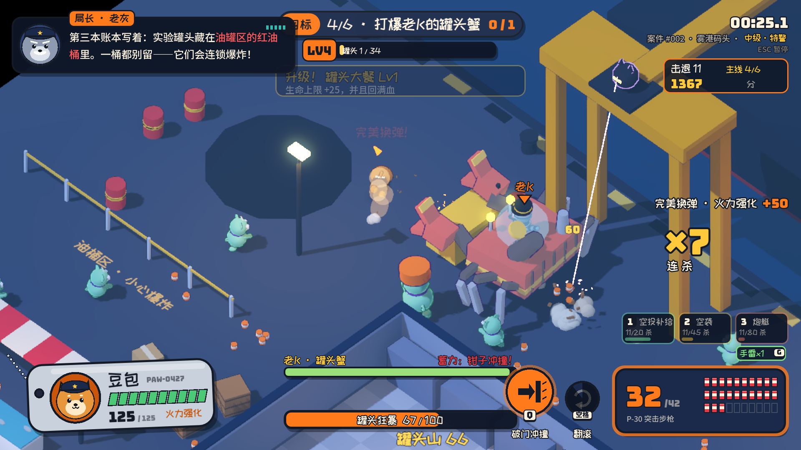
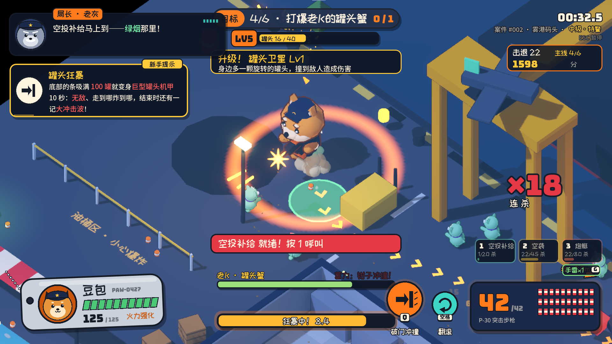
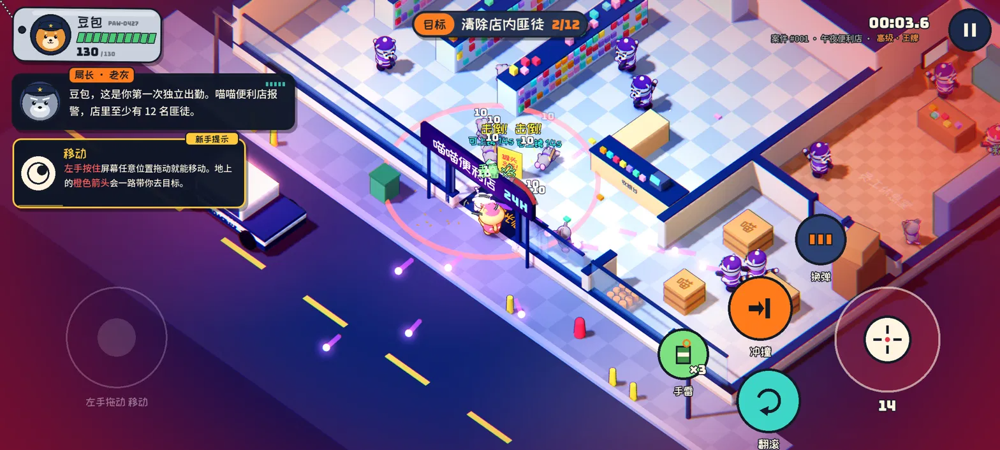
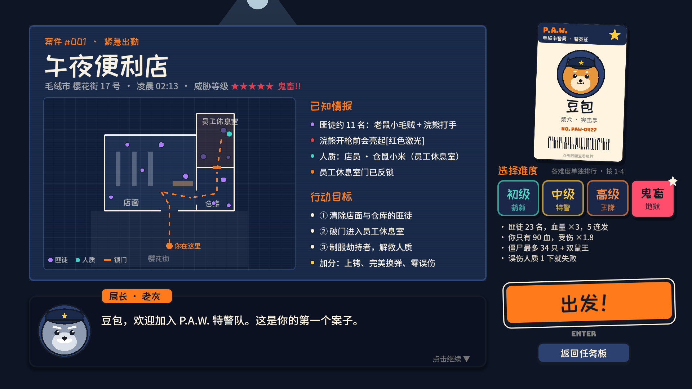

# 爪爪特警 · PAW S.W.A.T.

**猫咪出警，破门救人，火力全开！**

《爪爪特警》是一款用 Godot 制作的俯视角动作射击小游戏。玩家扮演柴犬特警「豆包」，序章闯入便利店清剿劫匪、破门解救人质；第二章杀进雾港码头，砸箱子吸罐头、一路升级，打爆浣熊老大老K 的罐头蟹机甲。

有不同难度和通关排行榜，主打短时间内的爽快战斗、武器变身和满屏清场。开发过程中使用了 AI 辅助。

当前源码版本：**v0.18** · Godot **4.6.3** · 序章：键鼠与触屏 · 第二章：仅 Windows 键鼠 · 自定义非商业源码许可

## v0.18 新增：第二章「雾港码头」

主菜单点 **CASE #002**，先在简报页选难度（初级 / 中级 / 高级 / 鬼畜）。一局 3–5 分钟，关键词：爽、解压、越打越强、满屏清场。





**主线 6 步**（顶部目标栏 + 地上橙色箭头 + 目标头顶标记）：

1. 打碎货箱 —— 箱子、鱼箱、油桶、集装箱全都能打碎，罐头会自己飞进怀里。
2. 轰开 3 个红色集装箱，拿到老K 的账本。
3. 引爆红油桶 —— 卧底黑猫「夜影」爬上龙门吊狙击支援。
4. 打爆老K 的**罐头蟹机甲**：钳子冲撞、跺地、开舱放鼠、罐头炮、罐头弹幕，半血暴怒。
5. 坚守码头 50 秒，每 15 秒一波涨潮。
6. 跑上撤离艇，任务完成。

**本章玩法**

- **自动升级**：吸罐头攒经验，满了自动随机获得强化（连发、散射、爆炸弹、穿透、重拳、罐头卫星、自动手雷……），不暂停。
- **罐头狂暴**：吸满 100 罐变身巨型罐头机甲 10 秒，无敌，踩到哪炸到哪。
- **连杀支援**：按 1 / 2 / 3 呼叫空投补给 / 空袭 / 炮艇。
- **步枪 30 发弹匣**：打空自动换弹，R 手动换弹；换弹条走到亮色区域再按一次 R = 完美换弹（火力强化 4 秒）。换弹完成会震开身边的僵尸鼠。
- **掉落**以散弹枪为主，另有火箭、冲锋枪（激光和磁轨炮已从本章删除）。
- **解压反馈**：僵尸鼠被打飞、会掉进海里；短时间连杀结算「连爆 / 大爆杀 / 清场」；胖胖鼠打死会撑爆炸飞周围；油桶连锁爆炸。
- **更难**：高级 / 鬼畜的鼠潮更多更快更疼；僵尸鼠会「扑咬」（发红蹲一下就扑过来，横移或翻滚躲）；定时来一只精英鼠王。

完整设计见 [第二章剧本与设计](docs/CHAPTER2-SCRIPT.md)。



## 玩法介绍

你将加入 P.A.W. 特警队，在「午夜便利店」执行救援任务。游戏采用 45° 等距俯视视角，围绕短局战斗、武器切换和人质救援展开。

1. **突入便利店**：跟随地面橙色箭头，清除店面与仓库中的匪徒。浣熊开枪前会亮起红色激光，及时翻滚或利用柜台、箱子掩护。
2. **破门救人**：冲撞或互动打开员工休息室的锁门，抓住子弹时间制服劫持者，再解救人质，让人质撤离到警车。
3. **迎战僵尸潮**：拾取空投神器和补给，在 60 秒的僵尸狂潮中坚持战斗；还须消灭当前难度要求的鼠王，才能完成任务。
4. **挑战更快通关**：结算查看成绩，尝试完美换弹、减少误伤，并在不同难度下刷新通关记录。

**v0.18 的匪徒规则：打空血量会晕倒冒星星，一段时间后醒来；按 E 上铐才算彻底制服。**

### 武器、变身与补给

- **神装武器**：喵喵散弹、罐头激光、肉垫火箭，以及空投神器「罐头加特林」。拾取神器时带有变身特写。
- **随时切换**：拾取的神装保存在本局武器库中；同种武器再次拾取可叠加弹药，耗尽后才消失。
- **完美换弹**：换弹进度进入黄色区域时，再按一次换弹键，获得 4 秒火力强化。
- **罐头手雷**：范围爆炸，最多携带 3 颗；神装与手雷不会伤害人质。
- **护盾与医疗补给**：僵尸潮提供临时护盾及限额医疗补给。护盾提供 5 秒无敌；医疗补给单件最多恢复 35 HP，不超过血量上限。

## 四档难度

每档难度有独立的通关排名，敌人数量、火力、玩家生存能力及人质误伤容错各不相同。



| 难度 | 匪徒数量 / 血量 | 玩家血量 / 受伤倍率 | 僵尸同时在场上限 / 鼠王数量 | 人质误伤失败阈值 |
| --- | --- | --- | --- | --- |
| 初级 · 萌新 | 9 名 / ×0.5 | 200 HP / ×0.4 | 8 只 / 1 只 | 5 次 |
| 中级 · 特警 | 11 名 / ×1 | 100 HP / ×1 | 16 只 / 1 只 | 3 次 |
| 高级 · 王牌 | 16 名 / ×1.7 | 130 HP / ×1.25 | 26 只 / 2 只 | 2 次 |
| 鬼畜 · 地狱 | 23 名 / ×3 | 90 HP / ×1.8 | 34 只 / 3 只 | 1 次 |

截图由作者提供，部分画面可能来自较早版本；当前规则与数值以 v0.18 源码为准（上表为序章数值，第二章的难度差异见 [第二章剧本与设计](docs/CHAPTER2-SCRIPT.md)）。

## 操作方式

### 电脑键鼠

| 操作 | 按键 |
| --- | --- |
| 移动 | WASD / 方向键 |
| 瞄准 / 射击 | 鼠标移动 / 左键 |
| 精准瞄准 | 鼠标右键 |
| 翻滚躲弹 | 空格 / Shift |
| 换弹 / 完美换弹 | R；进入黄色区域时再按一次 |
| 冲撞 / 撞门 | Q |
| 互动破门 / 解救人质 | E / F |
| 切换武器 | Tab / X / 滚轮向下 |
| 投掷手雷 | G |
| 连杀支援（第二章） | 1 空投补给 / 2 空袭 / 3 炮艇 |
| 暂停 | Esc / P |

### 手机与平板（仅序章）

左侧按住拖动移动，右侧开火摇杆可锁定目标自动连射，也可拖动手动瞄准；点击敌人可切换锁定目标。屏幕按钮负责翻滚、冲撞、换弹、手雷、武器切换和互动。暂停菜单中可调整瞄准方式、声音及震动。第二章目前只支持 Windows 键鼠。

## 在 Godot 中运行

1. 安装 [Godot 4.6.3 标准版](https://godotengine.org/download/)（无需 .NET）。这是随包文档记录的验证与导出版本。
2. 下载本仓库，或执行：

   ```bash
   git clone https://github.com/namjeesung/paw-swat.git
   ```

3. 打开 Godot，选择「导入」，载入 `GodotProject/project.godot`。
4. 等待首次资源导入完成，按 **F5** 运行。

可在命令行中预览触屏布局：

```bash
godot --path GodotProject -- --touch
```

仓库提供可编辑源码、Web/Android 导出预设和开发文档。自行导出需安装相应 Godot 导出模板；Android 还需配置 SDK 和自己的签名。**本次 GitHub 上传未新增可执行安装包，也未部署网页或排行榜服务器。**

## 通关排行榜

- **本机记录**：按难度保存通关成绩。
- **第二章**：结算页按难度记录本机最佳综合分。
- **独立服务器榜**：仓库保留可选的 Cloudflare Workers / D1 排行榜服务源码；自行部署后，在 `GodotProject/leaderboard.cfg` 填写服务地址。默认地址为空。

v0.18 源码不含 v0.12.x 的 B 站 Toy 排行榜桥接（`web/toy_bridge.js`）和 Edge 输入模式修正；这些历史记录仍保留在 `docs/v0.12.1`、`docs/v0.12.2`。

## 源码结构

```text
GodotProject/                 Godot 工程
  project.godot               项目入口配置
  scenes/                     场景
  scripts/actors/             玩家、匪徒、人质与子弹
  scripts/world/              关卡流程、场景与相机
  scripts/ui/                 任务板、简报、HUD、排行榜与结算
  scripts/autoload/           全局状态、声音与联网
  assets/                     字体与声音资源
  shaders/                    视觉效果
  scripts/world/harbor_*.gd   第二章：码头关卡、地图、连杀支援
  scripts/world/rat_king.gd   第二章 Boss 大脑（罐头蟹技能与暴怒）
  scripts/test/autotest.gd    自动测试机器人（--autotest，第二章加 --harbor）
  web/                        网页导出用文件
server/leaderboard/           可选独立排行榜服务
docs/                        开发记录、验证报告与截图
LICENSE                      自定义非商业源码许可
THIRD_PARTY_NOTICES.md        第三方组件与字体许可说明
```

## 版本与开发记录

开发日志见 [DEVLOG](docs/DEVLOG.md)，第二章设计见 [CHAPTER2-SCRIPT](docs/CHAPTER2-SCRIPT.md)。

v0.18 上传前用 Godot 4.6.3 做过的自动检查：第二章机器人在四档难度各跑一局，初级、中级通关，高级、鬼畜机器人阵亡（这是机器人打不过，不是报错），全程无脚本错误；序章中级通关；护盾回归 43 项、医疗补给回归 110 项、提示卡布局 9 项全部通过。这些是逻辑和流程检查，不等于真人试玩或听音验收。`docs/v0.11`、`docs/v0.12.x` 等历史文档仅供开发参考。

## 许可与商业授权

Copyright © 2026 **[namjeesung](https://github.com/namjeesung)**。

本项目采用[自定义非商业源码许可](LICENSE)：

- 非商业用途可免费使用、修改和再分发，须保留作者署名、版权声明及许可，并标明修改。
- 售卖、广告变现、内购、付费服务及其他商业用途，必须事先获得 **namjeesung 的书面授权**。
- 第三方代码和素材继续遵守各自原许可，不纳入本项目的重新授权；详见[第三方许可说明](THIRD_PARTY_NOTICES.md)。

这是一份自定义非商业源码许可；正式商业授权前建议进行法律审阅。商业授权请通过作者 GitHub 主页所列联系方式联系。

公开后他人可以保留副本；即使之后将仓库改为私有，既有 fork 或本地副本仍会存在。参见 [GitHub 许可说明](https://docs.github.com/en/repositories/managing-your-repositorys-settings-and-features/customizing-your-repository/licensing-a-repository)。
